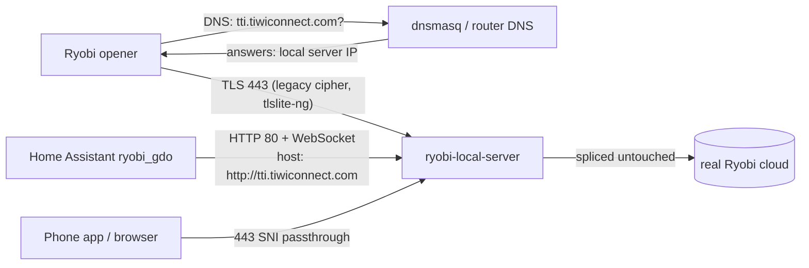

# ryobi-local-server

> **Local LAN emulator for the Ryobi GDO cloud API** — replaces `tti.tiwiconnect.com` on your network so the [ryobi_gdo](https://github.com/catduckgnaf/ryobi_gdo) Home Assistant integration works even when Ryobi's servers are down.

Addresses [issue #65](https://github.com/catduckgnaf/ryobi_gdo/issues/65) — _"Control the GD200 directly via LAN, bypassing the app completely."_

**Compatible hardware:** Ryobi GDO125, GDO201, and GD200 garage-door openers.

## Opener modes (verified 2026-11-01, add-on 1.2.7, GD200 fw 1.0.7)

| Mode | Cloud needed | Status |
|---|---|---|
| `local` (recommended) | **No** | Verified on catduck's hardware 2026-11-01: opener authorized locally on connect, light on/off round trip confirmed by the opener's own `srvSetModuleStatus` telemetry, HA shows `Local Server`. |
| `takeover` | Yes, at every reconnect | Cloud-first authorization ordering fixed in 1.2.6 (#13). Not re-tested live after the fix. |
| `cloud` / `cloud_relay: true` | Yes, always | Capture/diagnostic only. The opener talks to Ryobi; HA commands do not reach it. |
| `auto` | Depends | `cloud` when `cloud_relay` is on, otherwise `local`. |

**How local mode works.** The real cloud speaks first: it sends
`authorizedWebSocket` about 3 s after the WebSocket upgrade, and only then does
the opener send `wskClientRegister` / `wskServerRegister` and start streaming
telemetry. Before 1.2.6 the server waited for `wskServerRegister`, both sides
waited, and the opener dropped the session after about 20 s.

Requirements: the opener's trusted certificate and key in `opener_cert_pem` /
`opener_key_pem` (a self-signed fallback is rejected by the opener), DNS for
`tti.tiwiconnect.com` pointing at this server, and TCP 443 reachable.

Light on/off and door open/close are sent on the physical socket as a 5 byte
`gdoModuleCommand` (`msgType 16, moduleType 5, portId 7`): light `/wH///8=` on,
`/wD///8=` off; door `////Af8=` open (captured), `////AP8=` close (inferred from
the open frame and the light 01/00 pattern; verified live 2026-11-01 23:09 ET). Vacation and
fan commands are rejected rather than guessed. Door telemetry byte 5 uses the
cloud `doorState` enum (0 closed, 1 open, 2 closing, 3 opening, 4 fault).
Telemetry, not command acknowledgement, updates state. Commands with no
physical opener socket, or that cannot be delivered, return a JSON-RPC error
and change nothing (#10). Never use unverified HA state for auto-close safety.

---

## Quick Start

1. Run the local server on your LAN and note its LAN IP.
2. In UniFi, open **Settings > Routing > DNS** and add an A record: `tti.tiwiconnect.com` → the server's LAN IP. Ensure clients and the opener use this DNS server.
3. Publish or allow TCP 443 from the opener to the server for its legacy TLS connection. Home Assistant uses HTTP on port 80; set the integration host to `http://tti.tiwiconnect.com` (including `http://`).
4. Verify DNS resolves to the server IP before configuring Home Assistant.



The phone app's TLS connection is passed through by SNI, rather than terminated as the local Home Assistant HTTP connection is.

### Troubleshooting

| Symptom | Cause and action |
|---|---|
| `NO_SHARED_CIPHER` | The opener uses a legacy TLS cipher. Use the project's `tlslite-ng` listener; do not substitute a standard OpenSSL TLS listener. |
| `Not a PEM private key file` | A missing optional certificate value may have been written as literal `null`. Upgrade to 1.2.5 or later and check the add-on's key configuration. |
| Opener not connecting | Confirm `tti.tiwiconnect.com` resolves to the server IP and TCP 443 is published/allowed to the server. |
| Home Assistant certificate errors | Set the integration host to `http://tti.tiwiconnect.com`; omitting `http://` makes it use HTTPS. |

### UniFi DNS

In UniFi, go to **Settings > Routing > DNS** and create an A record for `tti.tiwiconnect.com` pointing to the LAN IP of the machine running this server. Make sure the opener and Home Assistant clients use the UniFi DNS resolver.

DNS is required. The door and Home Assistant look up `tti.tiwiconnect.com`. This project answers that name with your server. The Home Assistant add-on includes that DNS server (dnsmasq, the same job as one AdGuard rewrite). Docker starts the same DNS as a second container. Details are in [DNS](#dns).

### Home Assistant add-on

[](https://my.home-assistant.io/redirect/supervisor_add_addon_repository/?repository_url=https%3A%2F%2Fgithub.com%2Fcatduckgnaf%2Fryobi-local-server)

1. Add the repository and install **Ryobi GDO Local Server**.
2. Set `device_id`. Leave `dns_enabled` on. Start the add-on.
3. In the add-on log, copy `Point your router's DNS to: ...`.
4. On the router, set the LAN DNS server to that IP.
5. From a computer on the same Wi-Fi, `nslookup tti.tiwiconnect.com` must print that IP. A public address means the router change did not take. Stop there.
6. In the Ryobi integration, set **Host** to `http://tti.tiwiconnect.com`.

The `http://` does not skip DNS. DNS turns the name into your machine. The prefix makes Home Assistant use port 80. Without it, Home Assistant uses HTTPS and rejects the certificate the add-on generates.

Step by step, including a port-53 clash with an existing AdGuard: [add-on documentation](ryobi_gdo_local/DOCS.md).

### Docker

Linux only for the DNS container (`network_mode: host`). Mac and Windows Docker Desktop cannot answer LAN DNS this way. Use the add-on there.

```bash
git clone https://github.com/catduckgnaf/ryobi-local-server
cd ryobi-local-server
cp config/config.yaml.example config/config.yaml
# Edit config/config.yaml (device_id).
export RYOBI_HOST_IP=192.168.x.x   # this machine's LAN address, not a container IP
docker compose up -d
```

`ryobi-dns` is the same dnsmasq the add-on runs. Point the router's LAN DNS server at `RYOBI_HOST_IP`. Compose publishes port 80 for Home Assistant and port 443 for the opener. The opener uses TLS on 443 after the name lookup. Then:

```bash
nslookup tti.tiwiconnect.com
# Address must be RYOBI_HOST_IP
curl -sD- http://tti.tiwiconnect.com/health | head
```

In the Ryobi integration, set **Host** to `http://tti.tiwiconnect.com`.

If `ryobi-dns` exits immediately, port 53 is already taken. Free it, or do not start `ryobi-dns` and add the one rewrite on the DNS server you already run. Do not run two.

---

## How it Works

The Ryobi GDO125, GDO201, and GD200 devices and the HA integration communicate exclusively with `tti.tiwiconnect.com` via:

| Protocol | Endpoint | Purpose |
|---|---|---|
| HTTP | `POST /api/login` | Get API key |
| HTTP | `GET /api/devices` | List devices |
| HTTP | `GET /api/devices/<id>` | Device detail + state |
| WS | `/api/wsrpc` | Real-time push/commands |

This server reimplements those endpoints locally. DNS for `tti.tiwiconnect.com` must answer with this machine, and the integration Host must be `http://tti.tiwiconnect.com` so it uses port 80. The add-on also listens on 443 with a certificate it generates. Home Assistant will not trust that certificate, which is why the host needs the `http://` prefix.

```
Home Assistant
    │  HTTP + WSS
    ▼
ryobi-local-server  (your machine, port 80)
    ├── /api/login          ← returns a local API key
    ├── /api/devices        ← returns device list from memory
    ├── /api/devices/<id>   ← returns full deviceTypeMap
    └── /api/wsrpc (WS)    ← real-time commands + push updates
    │
    ├── /state (GET)        ← debug: view current state
    └── /health             ← liveness check
    │
    └── [optional] polls real Ryobi cloud every 30s
        to keep state current (graceful degradation)
```

---

## DNS

The name `tti.tiwiconnect.com` is the whole product. The opener and Home Assistant ask some DNS server where that name is. Until the answer is your machine, they are talking to Ryobi.

The add-on starts dnsmasq on port 53. Docker starts the same program as the `ryobi-dns` container. Either one does exactly one special thing:

- `tti.tiwiconnect.com` → your machine's LAN IP
- every other name → `1.1.1.1` and `8.8.8.8`

A DNS server that nobody asks is unused. The router has to hand your machine out as the LAN DNS server. That is the step other people miss. The add-on cannot change the router.

Check, from a computer on the Wi-Fi, before you touch the integration:

```bash
nslookup tti.tiwiconnect.com
```

A private address (192.168..., 10..., 172.16...) means DNS is working. A public address means it is not. A VPN, Android Private DNS, or iCloud Private Relay ignores the router and keeps returning the public address. Turn those off while testing.

Then set the integration Host to `http://tti.tiwiconnect.com`. Home Assistant looks the name up, which is the DNS, and connects to port 80. Leaving the host as `tti.tiwiconnect.com` with no `http://` uses HTTPS, and Home Assistant rejects the certificate the server generates. The lookup can be right and the integration still fails.

### Already running AdGuard, Pi-hole, or UniFi

Port 53 can only have one listener. If something else is already your DNS, turn the add-on's `dns_enabled` off (and do not start `ryobi-dns`) and add one rewrite there:

- Domain: `tti.tiwiconnect.com`
- Answer: the machine running this server

Do not also point the router at this add-on. One DNS, one rewrite.

### Cloud polling

Leave `cloud_poll: false`. If you turn it on, this server process must still resolve `tti.tiwiconnect.com` to Ryobi's public address while every other device resolves it to you. The Compose file gives the application container `1.1.1.1` and `8.8.8.8` for that reason. A router that intercepts every DNS query makes that split impossible. Leave cloud polling off in that case.

---

## Configuration

Edit `config/config.yaml` (see [`config/config.yaml.example`](config/config.yaml.example) for all options):

```yaml
username: "your_ryobi_email@example.com"   # optional, used for cloud polling
password: "your_ryobi_password"             # optional

devices:
  - device_id: "GDO_XXXXXXXXXX"  # your Ryobi device varName
    name: "Garage Door"

cloud_poll: false
poll_interval: 30
enforce_token: false
```

### Finding your device_id

Your `device_id` is the `varName` Ryobi uses — looks like `GDO_XXXXXXXXXX`. Find it by:

1. **From HA integration**: Check the existing ryobi_gdo integration config entry
2. **From the real API**: `curl "https://tti.tiwiconnect.com/api/devices" --data "username=you@email.com&password=yourpass" | python3 -m json.tool | grep varName`

---

## Debug Endpoints

After DNS is in place these work with the name. Before that, use the machine's IP.

```bash
curl http://tti.tiwiconnect.com/health
curl http://tti.tiwiconnect.com/state
curl http://tti.tiwiconnect.com/api/devices
```

---

## Running Tests

```bash
pip install -e ".[dev]"
pytest tests/ -v
```

---

## Architecture

```
server/
├── main.py         # CLI entrypoint (argparse, config loading, server start)
├── app.py          # aiohttp Application factory (routes, startup/cleanup hooks)
├── routes.py       # All HTTP + WebSocket handlers
├── state.py        # In-memory state store (thread-safe, WS broadcast, persistence)
├── models.py       # GarageDoorState dataclass + Ryobi JSON response builders
└── ryobi_proxy.py  # Optional: background task that polls real Ryobi cloud
```

---

## Open Work

Camera support is still a TODO. Firmware and camera-protocol inspection is ongoing. If you have relevant Ryobi firmware, protocol documentation, or useful captures, please open an issue with the details you can share.

---

## FAQ

**Q: Do I need to change the Ryobi integration?**  
A: Yes. Set Host to `http://tti.tiwiconnect.com`. DNS makes that name point at this server. The `http://` makes Home Assistant use port 80 instead of rejecting the add-on's certificate.

**Q: What happens if Ryobi's cloud is down?**  
A: The local server keeps answering. Leave `cloud_poll: false` unless you have the split DNS described above.

**Q: Does the opener itself use this?**  
A: Only if the opener's DNS server is this one. `nslookup tti.tiwiconnect.com` from the same Wi-Fi the opener uses must return your machine. If it returns a public address, the opener will keep using Ryobi. The add-on log is the confirmation: a connection from the opener's IP. A command webhook (`examples/esphome_ryobi.yaml`) does not depend on the opener accepting the local certificate.

**Q: Is this secure?**  
A: It's designed for trusted LAN use only — no authentication by default. Set `enforce_token: true` and use a firewall to restrict access to trusted hosts. Never expose port 80 to the internet.

**Q: Can I add multiple doors?**  
A: Yes — add multiple entries under `devices:` in config.yaml.

---

## License

MIT


## Opener certificate (Cloudflare token)

`local` mode needs an opener certificate that chains to **GlobalSign Root CA**. The opener ignores the hostname but rejects self-signed certificates. Google Trust Services (GTS) certificates chain to GlobalSign; this was verified on 2026-10-21. You prove ownership of a domain on Cloudflare through a DNS TXT record. The name does not have to point anywhere.

**Cloudflare API token**
1. https://dash.cloudflare.com → profile icon → **My Profile** → **API Tokens** → **Create Token**.
2. Template **Edit zone DNS** → **Use template**.
3. Permissions: `Zone / DNS / Edit`, plus a row `Zone / Zone / Read`.
4. Zone Resources: `Include / Specific zone / <your domain>`.
5. **Continue to summary** → **Create Token**. Copy it now, because Cloudflare shows it only once. Keep it in a password manager. It never goes into the add-on options.

**GTS account key (once):** in Google Cloud, enable the *Public Certificate Authority API*, then run `gcloud publicca external-account-keys create` in Cloud Shell. This gives a `keyId` and a `b64MacKey`, usable for one registration only.

**Issue with [lego](https://go-acme.github.io/lego/):**

```bash
export CF_DNS_API_TOKEN=<cloudflare token>
lego --server https://dv.acme-v02.api.pki.goog/directory \
  --eab --kid <keyId> --hmac <b64MacKey> \
  --email you@example.com --accept-tos \
  --dns cloudflare --dns.resolvers 1.1.1.1:53 \
  --key-type rsa2048 --preferred-chain "GlobalSign Root CA" \
  --domains ryobi-gdo.example.com run
```

Paste the full `.lego/certificates/<domain>.crt` into `opener_cert_pem` and the `.key` into `opener_key_pem`, then restart the add-on. Certificates last 90 days. To renew, run the same command with `renew` instead of `run`; the EAB flags are no longer needed. Keep a copy of both PEMs outside Home Assistant.

Full walkthrough, and the table of what works in `local` mode: [`ryobi_gdo_local/DOCS.md`](ryobi_gdo_local/DOCS.md#opener-certificate-required-for-local-mode). Remaining protocol mapping: [#14](https://github.com/catduckgnaf/ryobi-local-server/issues/14).
